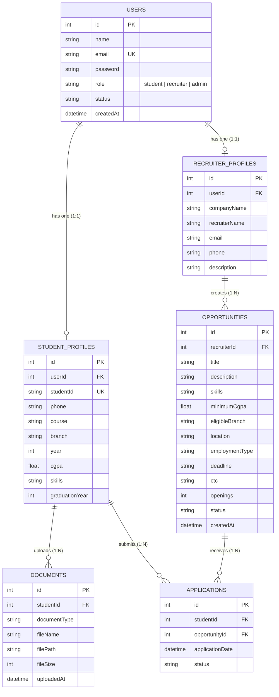

# PlaceCo – Student Placement & Career Management Portal

> **Software Engineering Course Project**  
> A centralized, role-based placement portal connecting Students, Corporate Recruiters, and Placement Administrators.  
> **GitHub Repository:** [https://github.com/Aryanbhutani14/PlaceCo.-](https://github.com/Aryanbhutani14/PlaceCo.-)

---

## 📖 1. Project Context & Objectives

In modern universities, managing campus placement drives across multiple engineering disciplines is challenging when done through scattered spreadsheets, emails, and isolated forms. **PlaceCo** provides a unified, secure web-based platform where:

- **Students** maintain their verified academic profile, skills, and resumes, browse placement drives, and submit job applications.
- **Recruiters** register company profiles, publish placement drives with minimum criteria (CGPA, eligible branches, deadlines), and evaluate applicants.
- **Administrators** oversee placement analytics, manage role credentials, and monitor institutional placement records.

---

## 👥 2. Engineering Team Division of Work (Team of 4)

To adhere to clean modular software engineering principles, the system is partitioned into **four independent modules**. Each team member is responsible for the design, implementation, and testing of one dedicated module:

| Module | Module Name | Assigned Team Member | Status | Description |
|---|---|---|---|---|
| **Module 1** | **Authentication & Role-Based Access Control (RBAC)** | **(Aryan Bhutani)** | ✅ **COMPLETED & OPERATIONAL** | Multi-role login, user registration, bcrypt password hashing, JWT stateless tokens, RBAC middleware, and role landing dashboards. |
| **Module 2** | **Student Profile & Document Management** | **Tanmay Sangwan** | ⏳ *Contract Defined & Ready* | Student academic details, CGPA verification, skills management, and resume/document upload with type/size validation. |
| **Module 3** | **Recruiter & Opportunity Management** | **Tanmay Kandwal** | ⏳ *Contract Defined & Ready* | Company profile management, placement opportunity CRUD, eligibility criteria setup, and applicant tracking. |
| **Module 4** | **Student Applications & Administration** | **Prashast** | ⏳ *Contract Defined & Ready* | Real-time eligibility evaluation (CGPA, branch, deadline), application submission, duplicate prevention, and admin oversight. |

---

## 🚀 3. Implemented: Module 1 – Authentication & Role-Based Login

Module 1 forms the security and architectural backbone of PlaceCo. It establishes identity verification, credential security, session persistence, and strict **Role-Based Access Control (RBAC)** across all subsequent modules.

### 3.1 Architectural Features
- **Stateless JWT Authentication:** Generates cryptographically signed JSON Web Tokens (`HS256`) containing user identifier, email, and role.
- **Strong Password Hashing:** Uses `bcryptjs` with 10 salt rounds. Plaintext passwords are never stored in the database.
- **True RBAC Enforcement:** Role restrictions are enforced at the backend middleware layer (`requireRole(...)`). Users cannot bypass role limits by manipulating client-side state or typing direct URLs.
- **Multi-Role Support:** Native authentication and redirection for:
  - 🎓 `student` $\rightarrow$ Redirects to `/student/dashboard.html`
  - 💼 `recruiter` $\rightarrow$ Redirects to `/recruiter/dashboard.html`
  - 🛡️ `admin` $\rightarrow$ Redirects to `/admin/dashboard.html`
- **Comprehensive Input Validation:**
  - Mandatory fields check (empty email, empty password).
  - Regex-based institutional email formatting.
  - Informative error responses (e.g. *"Invalid email or password"*, *"Email is required"*).
- **User Session Verification:** Protected endpoint `GET /api/auth/me` to fetch current user session data.
- **Interactive UI:**
  - Split-screen modern design with frosted glassmorphism and subtle CSS micro-animations.
  - **1-Click Evaluation Credentials:** Pre-configured buttons to instantly fill Student, Recruiter, or Admin credentials for rapid assessment.
  - Password visibility toggle (`👁`).
  - Interactive **RBAC Security Sandbox** on dashboards to test and demonstrate 403 Forbidden responses against unauthorized endpoints.

### 3.2 Authentication API Endpoints

| Method | Endpoint | Access | Description | Status Code |
|---|---|---|---|---|
| `POST` | `/api/auth/login` | Public | Validates credentials, checks role, returns JWT token & user info | `200 OK` / `400` / `401` |
| `POST` | `/api/auth/register` | Public | Registers a new Student or Recruiter account with profile initialization | `201 Created` / `400` / `409` |
| `GET` | `/api/auth/me` | Authenticated | Retrieves current authenticated session and profile details | `200 OK` / `401` |
| `POST` | `/api/auth/logout` | Authenticated | Clears user session | `200 OK` |

---

## 📋 4. Specifications for Remaining Modules (Teammates 2, 3, and 4)

The codebase has been structured with clean service-controller-route separation so teammates can build out their respective modules without modifying core authentication code:

```
src/modules/
├── auth/           <-- [MEMBER 1 - COMPLETED]
├── student/        <-- [TEAMMATE 2 - Profile & Documents]
├── recruiter/      <-- [TEAMMATE 3 - Opportunities & Drives]
└── admin/          <-- [TEAMMATE 4 - Applications & Admin]
```

### Module 2: Student Profile & Document Management (Teammate 2)
- **Directory:** `src/modules/student/`
- **Planned Endpoints:**
  - `GET /api/student/profile` – Retrieve student profile (CGPA, branch, student ID, course, skills).
  - `PUT /api/student/profile` – Update academic records with validation ($0 \le \text{CGPA} \le 10$).
  - `POST /api/student/documents` – Upload resume/academic records using Multer with 5MB cap and `.pdf, .doc, .docx` whitelist.
  - `DELETE /api/student/documents/:id` – Remove uploaded document.
- **Test Template:** `tests/templates/student.test.template.js` & `tests/templates/document.test.template.js`

### Module 3: Recruiter & Placement Opportunity Management (Teammate 3)
- **Directory:** `src/modules/recruiter/`
- **Planned Endpoints:**
  - `GET /api/recruiter/profile` – View company information.
  - `PUT /api/recruiter/profile` – Update company profile.
  - `POST /api/recruiter/opportunities` – Publish placement drive with title, skills, minimum CGPA, eligible branch, deadline, and CTC.
  - `GET /api/recruiter/opportunities` – View opportunities posted by the recruiter.
  - `PUT /api/recruiter/opportunities/:id` – Edit opportunity details.
  - `DELETE /api/recruiter/opportunities/:id` – Close or delete opportunity.
- **Test Template:** `tests/templates/recruiter.test.template.js`

### Module 4: Student Applications & Administration (Teammate 4)
- **Directory:** `src/modules/student/` & `src/modules/admin/`
- **Planned Endpoints:**
  - `GET /api/student/opportunities` – View available drives with automated eligibility calculations.
  - `POST /api/student/opportunities/:id/apply` – Submit application (enforces CGPA $\ge$ minimum, branch match, deadline check, duplicate check).
  - `GET /api/student/applications` – List student's submitted applications.
  - `GET /api/admin/dashboard` – System-wide placement metrics and user telemetry.

---

## 🗄️ 5. Relational Database Design

The prototype uses **SQLite** with strict foreign key constraints (`PRAGMA foreign_keys = ON;`) to provide relational ACID guarantees.



---

## 🔒 6. Institutional Authentication & Access Policy

- **Domain Restriction:** Authentication and user onboarding are restricted exclusively to official BML Munjal University email IDs (`@bmu.edu.in`). Non-BMU email domains are blocked at both API and client validation levels with HTTP `400 Bad Request`.
- **Pre-Seeded Accounts:** Default role test accounts for Student, Recruiter, and Administrator are initialized when executing the database seeder (`npm run seed`). Passwords are cryptographically salted and hashed using `bcryptjs` (10 rounds).
- **Security & Privacy:** User credentials and test accounts are managed locally and are strictly excluded from version control via `.gitignore`.

---

## 🧪 7. Automated Test Suite (Module 1: Auth & RBAC)

Automated integration tests ensure full coverage of the required test scenarios for Module 1:

| Test ID | Test Scenario | Verified Behavior | Status |
|---|---|---|---|
| **TC-LOGIN-01** | Valid Login | Returns valid JWT token, user metadata, and correct role-based `redirectUrl` for Student, Recruiter, and Admin. | ✅ PASS |
| **TC-LOGIN-02** | Invalid Password | Rejects incorrect credentials with `401 Unauthorized` and message *"Invalid email or password"*. | ✅ PASS |
| **TC-LOGIN-03** | Empty Credentials | Rejects empty email or empty password with `400 Bad Request` validation error. | ✅ PASS |
| **TC-LOGIN-04** | Role-Based Access Control | Strictly denies cross-role requests (e.g. Student accessing recruiter routes returns `403 Forbidden`). | ✅ PASS |
| **TC-LOGIN-05** | BMU Domain Restriction | Strictly rejects non-`@bmu.edu.in` emails (e.g. `@gmail.com` or `@yahoo.com`) with `400 Bad Request`. | ✅ PASS |

To run the automated tests:
```bash
npm test
```

---

## 🛠️ 8. Installation & Setup Instructions

### Prerequisites
- **Node.js** (v18.x, v20.x, or v22.x)
- **NPM** (v9.x or later)

### Steps to Run Locally

1. **Clone the repository:**
   ```bash
   git clone https://github.com/Aryanbhutani14/PlaceCo.-.git
   cd PlaceCo.-
   ```

2. **Install project dependencies:**
   ```bash
   npm install
   ```

3. **Initialize and seed the database:**
   ```bash
   npm run seed
   ```

4. **Run the automated test suite:**
   ```bash
   npm test
   ```

5. **Start the local server:**
   ```bash
   npm start
   ```

6. **Open in browser:**
   Navigate to [http://localhost:3000](http://localhost:3000) (automatically redirects to the Login portal).

---

## 📂 9. Project Directory Structure

```text
PlaceCo/
├── .env.example                     # Environment template
├── .gitignore                       # Git ignore rules
├── package.json                     # NPM dependencies and scripts
├── server.js                        # HTTP server entrypoint
├── README.md                        # Project documentation & team division
│
├── src/
│   ├── app.js                       # Express app configuration & middleware
│   │
│   ├── shared/                      # Shared core utilities
│   │   ├── db/
│   │   │   ├── connection.js        # SQLite database connection
│   │   │   ├── schema.sql           # Relational table schema
│   │   │   └── seeder.js            # Initial test seed records
│   │   ├── middleware/
│   │   │   ├── auth.middleware.js   # JWT verification & RBAC authorization
│   │   │   ├── upload.middleware.js # Multer file upload handler
│   │   │   └── error.middleware.js  # Global centralized error handler
│   │   ├── utils/
│   │   │   ├── auth.util.js         # Bcrypt hashing & JWT signer
│   │   │   └── response.js          # Standardized JSON response wrapper
│   │   └── validation/
│   │       └── validators.js        # Input validators & eligibility evaluator
│   │
│   └── modules/
│       ├── auth/                    # [MODULE 1: IMPLEMENTED]
│       │   ├── auth.controller.js
│       │   ├── auth.routes.js
│       │   └── auth.service.js
│       │
│       ├── student/                 # [MODULE 2: TEAMMATE 2]
│       │   ├── student.controller.js
│       │   ├── student.routes.js
│       │   └── student.service.js
│       │
│       ├── recruiter/               # [MODULE 3: TEAMMATE 3]
│       │   ├── recruiter.controller.js
│       │   ├── recruiter.routes.js
│       │   └── recruiter.service.js
│       │
│       └── admin/                   # [MODULE 4: TEAMMATE 4]
│           ├── admin.controller.js
│           ├── admin.routes.js
│           └── admin.service.js
│
├── public/                          # Frontend Static Assets
│   ├── index.html                   # Smart role-aware redirector
│   ├── login.html                   # Modern Login & Registration UI
│   ├── student/
│   │   └── dashboard.html           # Student Role Landing Dashboard
│   ├── recruiter/
│   │   └── dashboard.html           # Recruiter Role Landing Dashboard
│   ├── admin/
│   │   └── dashboard.html           # Admin Role Landing Dashboard
│   ├── css/
│   │   ├── main.css                 # Design system tokens & base controls
│   │   ├── auth.css                 # Login page glassmorphic styles
│   │   └── dashboard.css            # Dashboard layout & security sandbox styles
│   ├── js/
│   │   ├── api.js                   # Client-side JWT manager & RBAC guards
│   │   └── auth.js                  # Login/Register DOM event controller
│   └── uploads/
│       └── .gitkeep                 # Document upload storage directory
│
└── tests/
    ├── auth.test.js                 # TC-LOGIN-01 to TC-LOGIN-04 test suite
    └── templates/                   # Test templates for teammates
        ├── student.test.template.js
        ├── document.test.template.js
        └── recruiter.test.template.js
```

---

## 🛡️ 10. License & Academic Attribution
Developed for the **Software Engineering Course Evaluation**.  
All rights reserved © 2026 **PlaceCo Team**.
